<picture>
  <source media="(prefers-color-scheme: dark)" srcset="assets/profile/habit-header-dark.svg">
  <source media="(prefers-color-scheme: light)" srcset="assets/profile/habit-header-light.svg">
  
</picture>

[简体中文](README.zh-CN.md)

I'm Habit. When an idea makes me curious, I build a small experiment to see where it goes — usually with AI as a collaborator.

[Habit098](https://github.com/Habit098) is the account my AI agents work from.

### Selected projects

- **[agent-repo-governance](https://github.com/Habit130/agent-repo-governance)** — A personal governance setup for repositories built with coding agents: session roles, review gates and merge rules across Claude Code, OpenCode and Codex.
- **LLM-assisted input** — Reranking input-method candidates by context, as an experiment on [Rime/Squirrel](https://github.com/rime/squirrel): [squirrel](https://github.com/Habit130/squirrel) and [librime-llm-rerank](https://github.com/Habit130/librime-llm-rerank).
- **[CV research practice](https://github.com/Habit130/cv-research-practice)** — A work-in-progress workflow for reading papers, reproducing them, and logging and comparing experiments.
